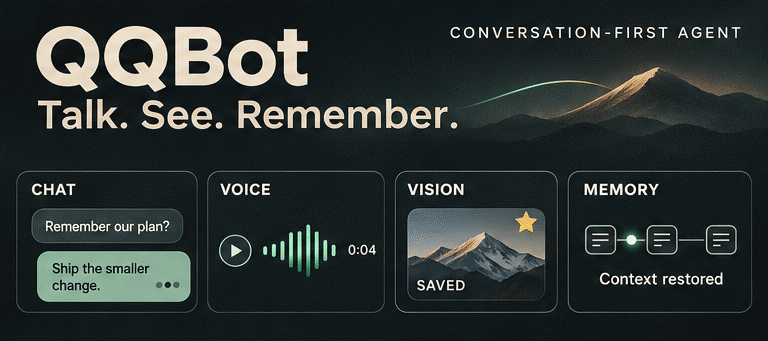

<div align="center">

<h1>QQBot</h1>

<p><strong>A conversation-first QQ agent.</strong></p>

<p>Chat naturally, understand images, speak back, and pick up where you left off.</p>

<p>
  
  
  
  
</p>

<p><strong>English</strong> · <a href="README.zh-CN.md">简体中文</a></p>

</div>

## Preview



<sub>Illustrated feature preview · <a href="assets/qqbot-preview.png">View the still image</a></sub>

## Features

- **Natural replies** — Responds to private messages, mentions, and contextually relevant group conversations, with short message bursts and selective quoting.
- **Proactive groups** — Chooses topics and follow-up times in joined groups, within a default activity window of 10:00–23:00 Asia/Shanghai.
- **Voice & expression** — Speaks with Edge TTS, sends images, GIFs and QQ emoji, and searches, reuses or saves account-favorite stickers.
- **Multimodal input** — Understands images and reads PDF, Word, Excel and text files, with SiliconFlow for OCR and voice transcription.
- **Persistent memory** — Saves conversations, summaries and attachments across restarts, with conversation-scoped retrieval and automatic storage limits.
- **Practical tools** — Uses a calculator, current time, weather and optional Tavily web search through the model's tool-calling loop.
- **Reliable messaging** — Deduplicates events, preserves conversation order, reconnects automatically and records confirmed deliveries without replaying uncertain sends.

## Installation & configuration

Requires **Python 3.12+**, **uv**, a running **NapCat** instance with QQ logged in, and an **OpenAI-compatible model** with tool calling; image input also requires vision support.

### 1. Install

```bash
git clone https://github.com/IT-coder-Yy/QQbot.git
cd QQbot
uv sync
cp .env.example .env
```

### 2. Connect your services

In NapCat, enable a **forward WebSocket server**, set an authentication token, and choose **Array** message format. QQBot connects to this server as a client. Fill in the matching credentials in `.env`:

| Service | Variables | Purpose |
| --- | --- | --- |
| **NapCat · required** | `NAPCAT_WS_URL`, `NAPCAT_TOKEN` | WebSocket address and matching token; the example uses `ws://127.0.0.1:3001`. |
| **LLM · required** | `LLM_BASE_URL`, `LLM_API_KEY`, `LLM_MODEL` | Your model provider's endpoint, API key and model name. |
| **Edge TTS** | `TTS_VOICE` | Voice replies; defaults to `zh-CN-XiaoxiaoNeural` and needs no API key. |
| **SiliconFlow · optional** | `SILICONFLOW_API_KEY` | Enables OCR and voice transcription; endpoint and model names are in `.env.example`. |
| **Web search · optional** | `TAVILY_SEARCH_API_KEY` | Enables Tavily web search for current information and source links. |
| **Jev · optional** | `TYPESAFE_API_KEY`, `TYPESAFE_DEFAULT_MODEL` | Decides when to join ordinary group conversations; defaults to `jev-latest`. |

The `qwen3.7-plus` preset uses built-in model limits. **For other models**, also set `LLM_CONTEXT_WINDOW` and `LLM_MAX_OUTPUT_TOKENS` to values supported by your provider; both are included as commented examples. The output limit plus the default 8,192-token safety margin must fit inside the context window.

To browse available TTS voices, run `uv run edge-tts --list-voices`. Existing deployments can keep their current `.env`; the example only lists service configuration. Advanced runtime options remain in [settings.py](src/qqbot/settings.py).

For legacy `.doc` / `.xls` files and Office chart rendering, install LibreOffice and suitable fonts. On Ubuntu/Debian:

```bash
sudo apt-get install libreoffice-writer libreoffice-calc fonts-noto-cjk
```

### 3. Make it yours

Edit [system.md](src/qqbot/prompts/system.md) to change the bot's personality, tone and chat style. Edit [intent.md](src/qqbot/prompts/intent.md) to change when it joins group conversations. **Restart the bot after editing prompts.**

## Run

```bash
uv run qqbot
```

The log prints `已连接 NapCat` when connected. Chat history and attachments live in `data/` by default; keep this directory when restarting or redeploying.

## Project structure

```text
src/qqbot/
├── agent.py       # Model and tool-calling loop
├── listen.py      # NapCat connection and message handling
├── dispatcher.py  # Conversation queues and input batching
├── proactive.py   # Proactive group-chat scheduling
├── context/       # Persistent history, summaries and token budgets
├── documents.py   # Document extraction and rendering
├── media.py       # Incoming attachments, OCR and transcription
├── outbound.py    # Voice, images, emoji and sticker favorites
├── prompts/       # Personality, intent and summary prompts
└── tools/         # Calculator, time, weather and web search
```
