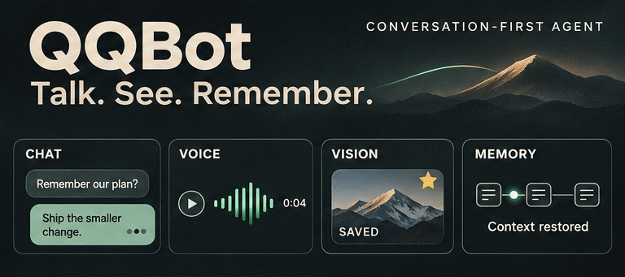

<div align="center">

<h1>QQBot</h1>

<p><strong>一个以自然对话为中心的 QQ 智能体。</strong></p>

<p>自然接话、看懂图片、用语音回应，也记得上次聊到了哪里。</p>

<p>
  
  
  
  
</p>

<p><a href="README.md">English</a> · <strong>简体中文</strong></p>

</div>

## 预览

<p align="center">
  
</p>

<p align="center"><sub>功能概念预览 · <a href="assets/qqbot-preview.png">查看静态图</a></sub></p>

## 当前功能

- **自然接话** — 响应私聊、@ 和适合参与的群聊，支持连发短句，并按语境选择是否引用消息。
- **主动聊天** — 在已加入的群中自主选题、回访话题并安排下次交流，默认活动时段为北京时间 10:00–23:00。
- **语音与表情** — 用 Edge TTS 发送语音，发送图片、GIF 和 QQ 表情，并检索、复用或自主新增账号收藏表情。
- **多模态理解** — 看懂图片，读取 PDF、Word、Excel 和文本文件，通过硅基流动进行 OCR 与语音转写。
- **持久记忆** — 跨重启保留聊天、摘要与附件，按会话检索历史，并自动管理存储额度。
- **实用工具** — 由模型调用计算器、时间、天气及可选的 Tavily 网页搜索。
- **可靠收发** — 对消息去重、按会话顺序处理、断线自动重连，仅记录确认送达的回复，结果未知时不重复发送。

## 安装与配置

需要 **Python 3.12+**、**uv**、已启动且 QQ 已登录的 **NapCat**，以及支持工具调用的 **OpenAI 兼容模型接口**；图片理解还需要模型支持视觉输入。

### 1. 安装

```bash
git clone https://github.com/IT-coder-Yy/QQbot.git
cd QQbot
uv sync
cp .env.example .env
```

### 2. 连接外部服务

在 NapCat 中启用**正向 WebSocket 服务端**，设置鉴权 Token，并选择 **Array 消息格式**。QQBot 作为客户端连接该服务，在 `.env` 中填写对应配置：

| 服务 | 变量 | 说明 |
| --- | --- | --- |
| **NapCat · 必填** | `NAPCAT_WS_URL`、`NAPCAT_TOKEN` | WebSocket 地址与对应 Token，示例地址为 `ws://127.0.0.1:3001`。 |
| **LLM · 必填** | `LLM_BASE_URL`、`LLM_API_KEY`、`LLM_MODEL` | 主模型服务地址、密钥与模型名称。 |
| **Edge TTS** | `TTS_VOICE` | 发送语音，默认音色为 `zh-CN-XiaoxiaoNeural`，不需要 API Key。 |
| **硅基流动 · 可选** | `SILICONFLOW_API_KEY` | 启用 OCR 与语音转写，服务地址和模型名称见 `.env.example`。 |
| **网页搜索 · 可选** | `TAVILY_SEARCH_API_KEY` | 启用 Tavily 搜索，查询最新信息并提供来源链接。 |
| **Jev · 可选** | `TYPESAFE_API_KEY`、`TYPESAFE_DEFAULT_MODEL` | 判断是否参与普通群聊消息，默认模型为 `jev-latest`。 |

`qwen3.7-plus` 使用程序内置的模型容量配置。**使用其他模型时**，还需按服务商支持的值填写 `LLM_CONTEXT_WINDOW` 和 `LLM_MAX_OUTPUT_TOKENS`，示例中已用注释保留；输出上限加上默认 8,192 token 的安全余量，必须小于上下文窗口。

运行 `uv run edge-tts --list-voices` 可查看可用音色。已有部署继续使用当前 `.env` 即可，示例文件仅保留服务配置；高级运行选项见 [settings.py](src/qqbot/settings.py)。

读取旧版 `.doc`、`.xls` 或渲染 Office 图表，需要安装 LibreOffice 和相应字体。Ubuntu/Debian 可执行：

```bash
sudo apt-get install libreoffice-writer libreoffice-calc fonts-noto-cjk
```

### 3. 修改提示词

编辑 [system.md](src/qqbot/prompts/system.md) 可调整机器人身份、语气与聊天风格；编辑 [intent.md](src/qqbot/prompts/intent.md) 可调整群聊接话判断。**修改后重启机器人生效。**

## 运行

```bash
uv run qqbot
```

连接成功后日志显示 `已连接 NapCat`。聊天与附件默认保存在 `data/`，重启或重新部署时保留该目录即可延续历史。

## 项目结构

```text
src/qqbot/
├── agent.py       # 主模型与工具调用循环
├── listen.py      # NapCat 连接与消息处理
├── dispatcher.py  # 会话队列与连续输入合并
├── proactive.py   # 主动群聊调度
├── context/       # 持久历史、摘要与 token 预算
├── documents.py   # 文档提取与页面渲染
├── media.py       # 附件接收、OCR 与语音转写
├── outbound.py    # 语音、图片、表情与账号收藏
├── prompts/       # 人设、接话与摘要提示词
└── tools/         # 计算器、时间、天气与网页搜索
```
